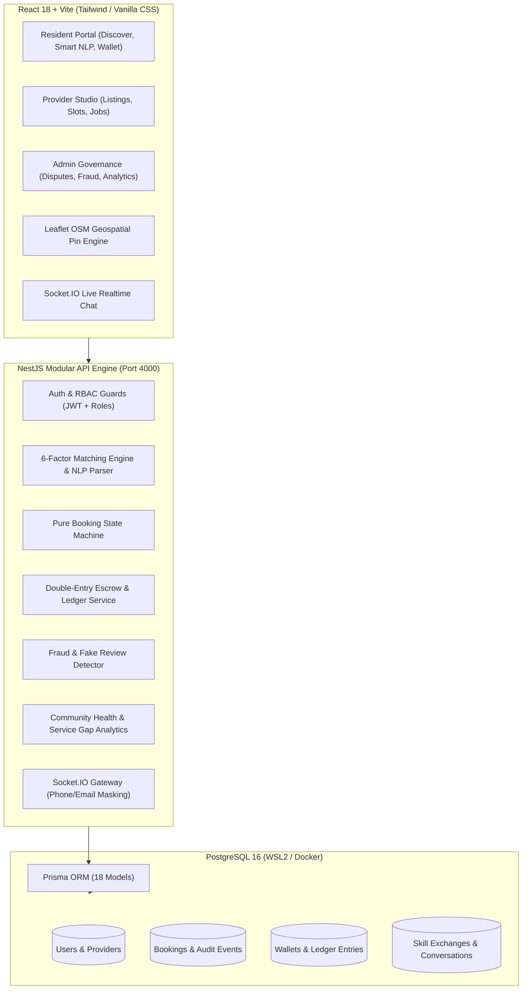

# 🏘️ Neighborly — Hyperlocal Community Services Platform

**Neighborly** is a full-stack hyperlocal community platform built for Chennai neighborhoods (**Ramapuram, Porur, Valasaravakkam, KK Nagar**). Residents discover, book, trade, and pay for everyday community services — repairs, tutoring, cooking, tailoring, tech help, pet care — from verified neighbors. Every booking runs through an explicit state machine with double-entry wallet escrow, explainable 6-factor provider matching, Bayesian trust scores, rule-based fraud detection, real-time masked chat, skill bartering, and an admin console for disputes and community analytics.

---

## 🌐 Live Demo

> _Coming soon._
>
> - Web app: `TBD`
> - API / Swagger docs: `TBD`

---

## 🧰 Tech Stack

| Layer | Technology |
|---|---|
| **Monorepo** | pnpm workspaces (`apps/api`, `apps/web`, `packages/shared`), TypeScript 5 |
| **Backend** | NestJS 10, Prisma 5 ORM, PostgreSQL 16, Passport JWT (access + refresh), bcrypt, class-validator, Socket.IO, `@nestjs/schedule`, Swagger/OpenAPI |
| **Frontend** | React 18, Vite, React Router, TanStack Query, Tailwind CSS, Leaflet / OpenStreetMap, Recharts, socket.io-client |
| **Testing** | Jest + ts-jest |
| **Infra (local)** | PostgreSQL via Docker Compose (optional) |

---

## 🚀 Local Setup

### 1. Prerequisites
- Node.js v20+
- pnpm (`npm i -g pnpm`)
- PostgreSQL 16 on `localhost:5432` — either your own install, or via Docker:
  ```bash
  docker compose up -d
  ```

### 2. Install dependencies
```bash
pnpm install
```

### 3. Configure environment
```bash
cp apps/api/.env.example apps/api/.env
cp apps/web/.env.example apps/web/.env   # optional, no variables required for local dev
```
Edit `apps/api/.env` and set `DATABASE_URL` and the two JWT secrets (generate with `openssl rand -hex 32`). The API refuses to sign tokens without them.

### 4. Create the database schema
```bash
pnpm --filter @neighborly/api exec prisma migrate deploy
```
If your local database was created earlier with `pnpm db:push`, mark the initial migration as applied instead:
`pnpm --filter @neighborly/api exec prisma migrate resolve --applied 20261016000000_init`

### 5. Seed demo data
```bash
pnpm seed
```
Optionally load the expanded dataset (20 providers, disputes, a flagged review):
```bash
pnpm --filter @neighborly/api seed:expanded
```

### 6. Run the app
```bash
pnpm dev
```
This starts the API and web app in parallel:
- **Web app:** http://localhost:5173
- **API:** http://localhost:4000/api/v1
- **Swagger docs:** http://localhost:4000/api/docs

---

## 👥 Demo Accounts

All accounts share the password **`Demo@123`**.

| Role | Email | Name | Neighborhood |
|---|---|---|---|
| **Requester (Resident)** | `requester@demo.in` | Priya Sundaram | Ramapuram |
| **Provider** | `provider@demo.in` | Karthik Raja | Ramapuram |
| **Admin** | `admin@demo.in` | Administrator | Chennai Metro |

---

## ☁️ Deployment

| Piece | Host | Config |
|---|---|---|
| Web (React/Vite) | Vercel | `vercel.json` (repo root) — builds `apps/web`, SPA rewrite to `index.html` |
| API (NestJS) | Render free web service | `render.yaml` Blueprint — builds shared + API, runs `prisma migrate deploy`, starts `node apps/api/dist/src/main.js` |
| Database | Neon PostgreSQL | use the **direct** (non-pooled) connection string as `DATABASE_URL` |

Environment variables:
- **Render (API):** `DATABASE_URL`, `CORS_ORIGIN` (the Vercel URL), `JWT_ACCESS_SECRET` / `JWT_REFRESH_SECRET` (auto-generated by the Blueprint), `JWT_ACCESS_EXPIRES_IN`, `JWT_REFRESH_EXPIRES_IN`. `PORT` is provided by Render.
- **Vercel (web):** `VITE_API_URL` and `VITE_SOCKET_URL`, both set to the Render API origin (e.g. `https://neighborly-api.onrender.com`).

Seed the hosted database once from your machine:
```bash
DATABASE_URL="<neon direct url>" pnpm seed
DATABASE_URL="<neon direct url>" pnpm --filter @neighborly/api seed:expanded
```

> The Render free tier sleeps after ~15 minutes idle; the first request after that takes up to a minute.

---

## 🧪 Tests

```bash
pnpm test
```

Runs the API's Jest suite, covering:
- `booking.state-machine.spec.ts` — state transitions & actor permissions
- `wallet.ledger.spec.ts` — double-entry invariant on top-up, hold, fee, and dispute split
- `matching.engine.spec.ts` — Haversine distance and urgent-mode weight reallocation
- `trust.score.spec.ts` — Bayesian prior convergence and penalties

---

## 🏛️ System Architecture



---

## 🧮 Mathematical Formulas & Technical Specifications

### 1. Pure Booking State Machine
Explicit state transition table enforcing legal actor roles and atomic database side effects:
$$\text{REQUESTED} \longrightarrow \text{ACCEPTED} \longrightarrow \text{SCHEDULED} \longrightarrow \text{IN\_PROGRESS} \longrightarrow \text{COMPLETED} \longrightarrow \text{PAID} \longrightarrow \text{REVIEWED}$$
- **Side Effects:**
  - `REQUESTED`: Escrow held in resident wallet.
  - `DECLINED / CANCELLED`: 100% immediate escrow refund to resident.
  - `COMPLETED`: Starts 48-hour auto-release countdown.
  - `PAID`: 95% payout to provider, 5% platform fee recorded.
  - `DISPUTED`: Escrow frozen pending admin mediation (100% Refund, 100% Release, or Custom Split).

### 2. Double-Entry Escrow Ledger Invariant
At all times across all financial operations:
$$\Delta = \text{totalBalances} + \text{totalHeld} + \text{totalPlatformFees} - \text{totalTopups} \equiv 0$$
Verified via `GET /api/v1/wallet/verify`.

### 3. Explainable 6-Factor Bayesian Trust Score (0 – 100)
1. **Verification Points (Max 20):** `NONE` = 0, `PHONE` = 5, `ID` = 15, `ADDRESS` = 20.
2. **Bayesian Rating (Max 25):**
   $$R_{\text{bayesian}} = \frac{C \cdot m + \sum_{i=1}^n r_i}{C + n} \quad (C=3.0, \, m=4.0)$$
   $$\text{Points} = \frac{R_{\text{bayesian}}}{5.0} \times 25$$
3. **Completion Rate (Max 20):** $(\text{completedJobs} / \text{acceptedJobs}) \times 20$.
4. **On-Time & Reliability (Max 15):** $\text{onTimeRate} \times 15$.
5. **Volume & Community Tenure (Max 10):** $\min(10, \text{completedJobs} \times 1.5 + \text{monthsTenure} \times 0.5)$.
6. **Review Authenticity (Max 10):** Proportion of unflagged reviews $\times 10$.
- **Penalties:** $-10$ per active/upheld dispute, $-5$ per provider cancellation.

### 4. 6-Factor Explainable Matching Engine
$$\text{Composite Score} = \sum_{j=1}^6 w_j \cdot f_j \cdot 100$$
| Factor | Standard Weight | Urgent Mode Weight | Description |
|---|:---:|:---:|---|
| **Distance Proximity** | 20% | **35%** | Haversine formula decay curve $e^{-d/3}$ |
| **Skill & Category Fit** | **30%** | 20% | Exact category specialization & keyword match |
| **Availability Fit** | 15% | **20%** | Configured weekly slots & immediate response |
| **Bayesian Trust** | 15% | 10% | Provider trust score / 100 |
| **Reliability** | 10% | 10% | $(0.6 \times \text{completion} + 0.4 \times \text{on-time})$ |
| **Price Fit** | 10% | 5% | Within resident max budget |

### 5. Community Health Index (0 – 100)
$$\text{Health} = 0.20 \times \text{Residents} + 0.25 \times \text{Fulfilment} + 0.15 \times \text{RepeatBookings} + 0.15 \times \text{LowDisputes} + 0.15 \times \text{AvgTrust} + 0.10 \times \text{CashlessActivity}$$

---


## 📂 Project Structure

```
neighborly/
├── apps/
│   ├── api/                     # NestJS backend service
│   │   ├── prisma/              # Schema & seed scripts
│   │   └── src/modules/
│   │       ├── auth/            # JWT authentication & guards
│   │       ├── bookings/        # State-machine & lifecycle
│   │       ├── wallet/          # Double-entry escrow ledger
│   │       ├── chat/            # Socket.IO & masking gateway
│   │       ├── reviews/         # Bayesian trust & fraud detector
│   │       ├── disputes/        # Dispute resolution & split engine
│   │       ├── exchanges/       # Skill barter & community credits
│   │       ├── matching/        # NLP parser & 6-factor algorithm
│   │       └── analytics/       # Community health & gap heatmap
│   └── web/                     # React 18 + Vite frontend
│       └── src/
│           ├── components/      # UI components, maps, layout
│           ├── pages/           # Requester, Provider, Admin, Public
│           └── lib/             # API client, INR formatting
└── packages/
    └── shared/                  # Common TypeScript interfaces & enums
```
