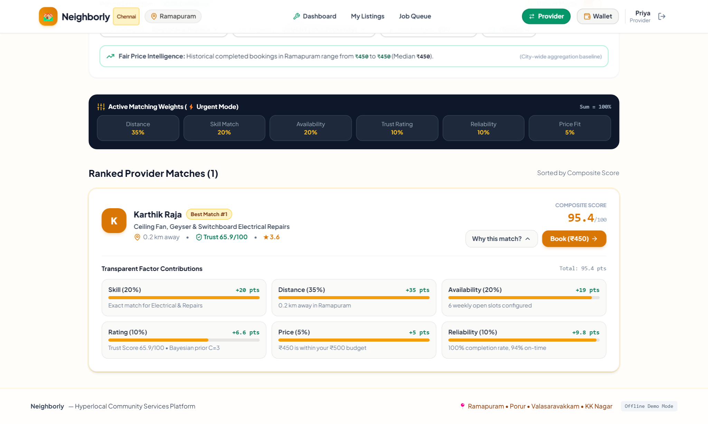
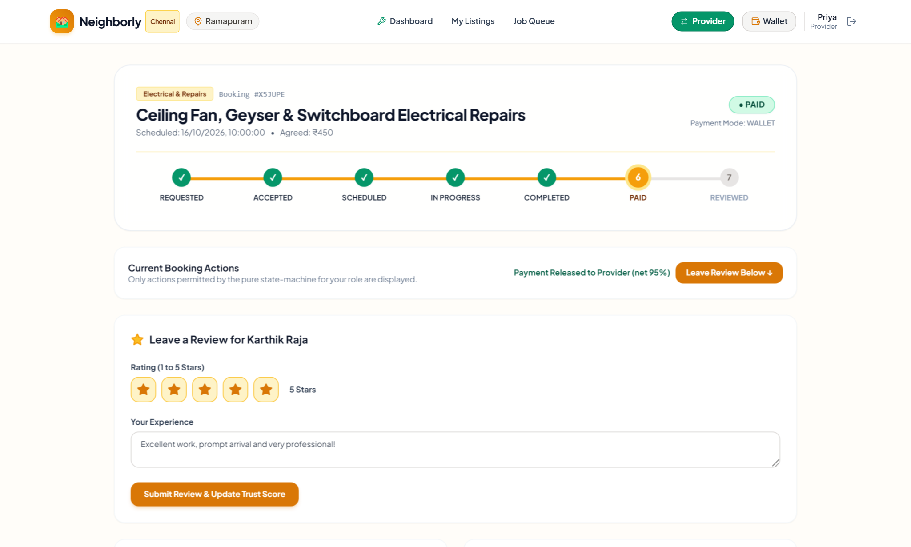
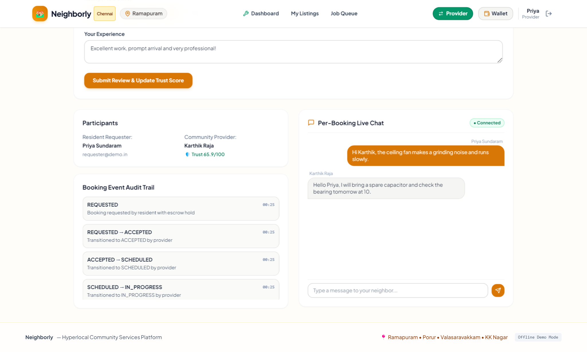
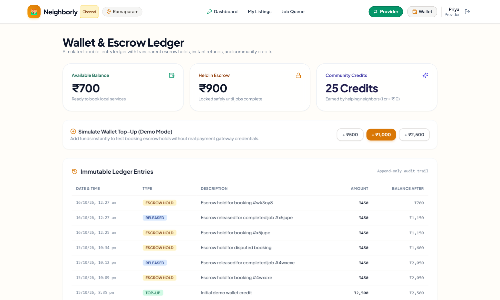
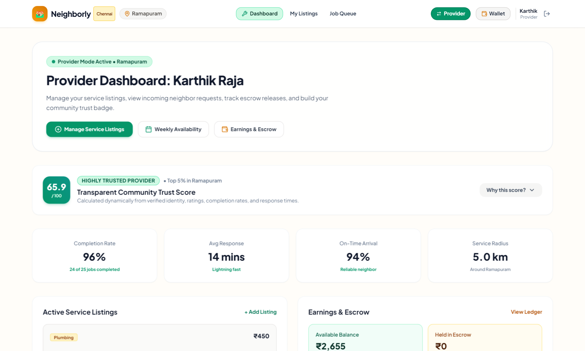
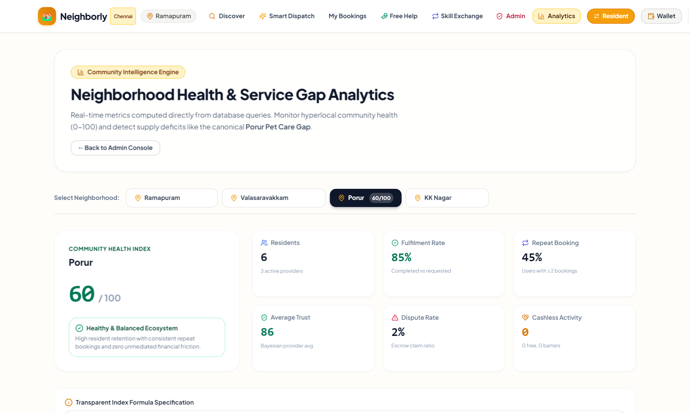
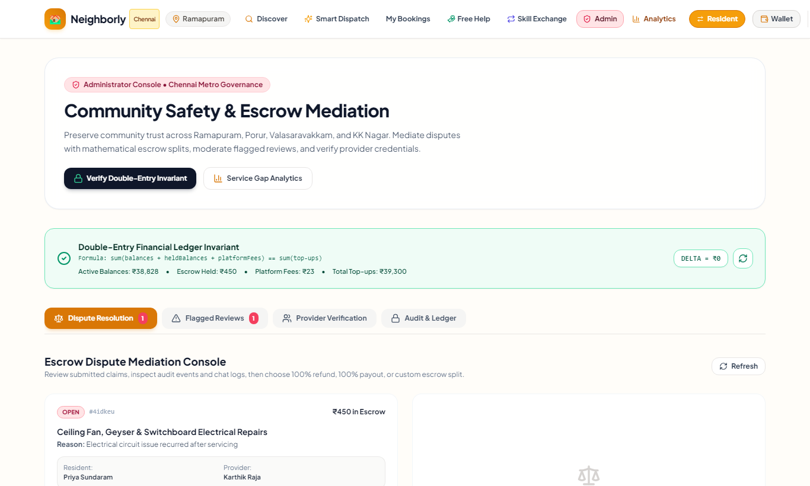
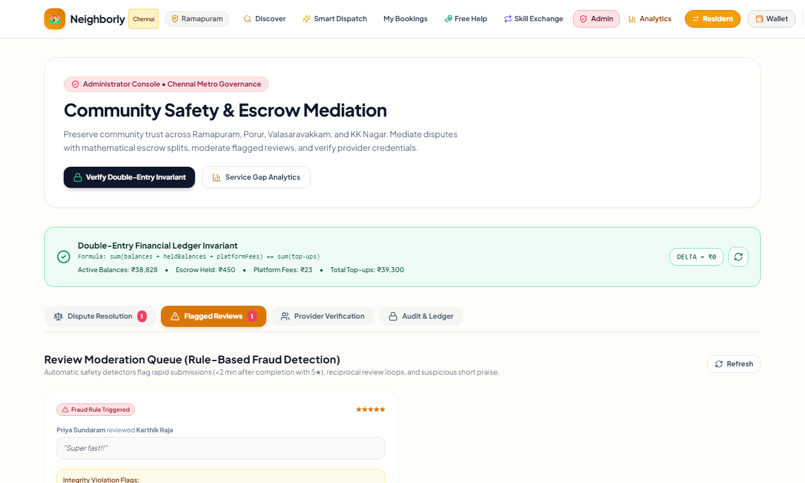
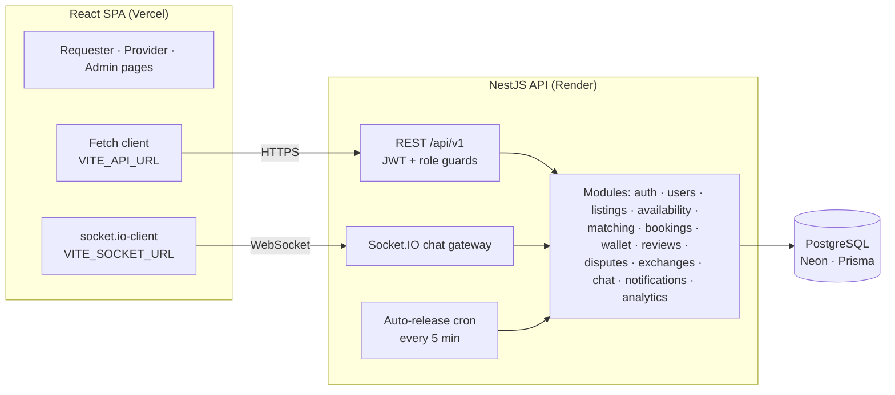

# 🏘️ Neighborly

**A hyperlocal community services platform for Chennai neighbourhoods.** Residents describe what they need in plain words, get matched with nearby neighbours who can help, pay safely through escrow, chat in real time, and leave reviews that feed an explainable trust score. Admins resolve disputes, moderate suspicious reviews and see which services each neighbourhood is missing.

### 🌐 [Live demo → neighborly-beige.vercel.app](https://neighborly-beige.vercel.app)  ·  [API docs (Swagger)](https://neighborly-api-33ge.onrender.com/api/docs)

| Role | Email | Password |
|---|---|---|
| Requester (resident) | `requester@demo.in` | `Demo@123` |
| Provider | `provider@demo.in` | `Demo@123` |
| Admin | `admin@demo.in` | `Demo@123` |

> ⏱️ The API runs on Render's free tier and **sleeps after ~15 minutes of inactivity**. If the site seems stuck, open [the API wake-up link](https://neighborly-api-33ge.onrender.com/api/v1/categories) and wait up to a minute for the JSON to appear, then reload the site.

---

## Contents

- [What it does](#what-it-does)
- [Screenshots](#screenshots)
- [How it works](#how-it-works)
- [Tech stack](#tech-stack)
- [Architecture](#architecture)
- [Run it locally](#run-it-locally)
- [Tests](#tests)
- [Deployment](#deployment)
- [Project structure](#project-structure)
- [Known limitations](#known-limitations)

---

## What it does

**Residents (requesters)**
- Type a need like *"fix my ceiling fan urgently tomorrow evening, budget 500"* — it is parsed into category, urgency, budget and a time window.
- See nearby providers ranked by a 0–100 score, with a **"Why this match?"** breakdown of all six factors.
- Book with **wallet escrow**: money is held until the job is done, then released to the provider (minus a 5% fee).
- Chat live with the provider; phone numbers and emails are masked until the provider accepts.
- Raise a dispute if something goes wrong, and leave a review afterwards.
- Offer free help for **community credits**, or swap skills on the **barter board**.

**Providers**
- Switch the same account into provider mode, create listings (fixed, hourly or free) and set weekly availability.
- Move jobs through the lifecycle: accept → schedule → start → complete.
- Build a **trust score** from verification, ratings, completion, punctuality, tenure and review authenticity.

**Admins**
- Resolve disputes with a full refund, full release, or a custom percentage split.
- Moderate reviews flagged by the fraud rules, and verify providers.
- View the **Community Health Index** and **service-gap analysis** per neighbourhood.
- Verify the ledger: total balances + escrow + fees must equal total top-ups.

---

## Screenshots

| Smart request & “Why this match?” | Booking timeline |
|---|---|
|  |  |
| **Live chat & booking audit trail** | **Wallet & escrow ledger** |
|  |  |
| **Provider dashboard & trust score** | **Community health analytics** |
|  |  |
| **Admin dispute console** | **Review moderation queue** |
|  |  |

---

## How it works

All scoring is **rule-based and explainable** — every number shown in the UI can be traced to the code below.

### 1. Request parser — `matching.service.ts`
- **Category:** 3 points if the category name/slug appears, +1 per matching keyword; highest wins.
- **Urgency:** words like *urgent, asap, now, today* → `URGENT`; *flexible, next week* → `LOW`.
- **Budget:** 2–6 digits next to `₹`, `rs`, `inr` or `budget`, stored in paise.
- **Time window** (`time-window.ts`, Indian Standard Time): *morning* 08:00–12:00, *afternoon* 12:00–17:00, *evening* 17:00–21:00, combined with *today* / *tomorrow*.

### 2. Matching — `findMatches`
Only active listings in the category are considered, and **a provider is excluded if the requester is farther away than the provider's service radius** (default 5 km). Each remaining listing gets six factor values (0–1), each multiplied by its weight × 100:

| Factor | Normal | Urgent | Value |
|---|:---:|:---:|---|
| Skill fit | 30% | 20% | 1.0 for the requested category |
| Distance | 20% | **35%** | 1.0 within 1 km, then `1 − (d − 0.5) / 8.5` (haversine distance) |
| Availability | 15% | 20% | 0.95 if the provider has weekly slots, else 0.6 |
| Rating / trust | 15% | 10% | trust score ÷ 100 (min 0.2) |
| Price fit | 10% | 5% | 1.0 within budget, else `1 − excess / budget` (min 0.1) |
| Reliability | 10% | 10% | `0.6 × completion rate + 0.4 × on-time rate` |

### 3. Trust score (0–100) — `reviews.service.ts`

| Factor | Max points |
|---|:---:|
| Verification (none / phone / ID / address → 0 / 5 / 15 / 20) | 20 |
| Bayesian rating `(3 × 4.0 + Σ ratings) / (3 + n)`, flagged reviews excluded | 25 |
| Completion rate | 20 |
| On-time rate | 15 |
| Volume & tenure `min(10, 1.5 × completed jobs + 0.5 × months)` | 10 |
| Review authenticity (share of unflagged reviews) | 10 |
| **Penalties:** −10 per dispute, −5 per cancellation; total clamped to 0–100 | |

Tiers: **Trusted** ≥ 50, **Highly Trusted** ≥ 70, **Pillar of the Community** ≥ 85.

### 4. Booking lifecycle & escrow — `booking.state-machine.ts`, `wallet.service.ts`

```
REQUESTED ─► ACCEPTED ─► SCHEDULED ─► IN_PROGRESS ─► COMPLETED ─► PAID ─► REVIEWED
    │            │            │                          │
    ├─► DECLINED └────────────┴─► CANCELLED              └─► DISPUTED ─► REFUNDED / PAID (admin)
    └─► CANCELLED                (full refund)                (escrow frozen)
```

- 12 allowed transitions, each limited to specific roles; anything else is rejected before touching the database.
- **REQUESTED** holds the price in escrow · **DECLINED/CANCELLED** refunds it · **COMPLETED** starts a 48-hour auto-release · **PAID** sends 95% to the provider and records a 5% platform fee.
- A cron job runs every 5 minutes to auto-release due payments; admins can fast-forward for demos.
- All amounts are integer **paise**, every money movement runs in a database transaction and is written to the ledger, and `GET /api/v1/wallet/verify` checks that `balances + held + fees = top-ups`.

### 5. Fraud signals on reviews
A review is flagged for moderation if it is a **5★ within 2 minutes of completion**, a **very short comment (< 8 characters) with a 1★ or 5★ rating**, or a **reciprocal review between the same two people within 48 hours**.

### 6. Community analytics — `analytics.service.ts`
- **Health index (0–100)** = residents (20) + fulfilment rate (25) + repeat bookings (15) + low disputes (15) + average trust (15) + free-help/barter activity (10).
- **Service gaps:** for each neighbourhood × category, `gap = max(0, demand − 2 × supply)`, where demand is bookings + requests by local residents and supply is local active listings.

---

## Tech stack

| Layer | Technology |
|---|---|
| Monorepo | pnpm workspaces, TypeScript 5 |
| Frontend | React 18, Vite, React Router 6, Tailwind CSS, Leaflet + OpenStreetMap, Recharts, Lucide icons, socket.io-client |
| Backend | NestJS 10, Prisma 5, PostgreSQL 16, Passport JWT (15-min access + 7-day refresh tokens), bcrypt, Socket.IO, `@nestjs/schedule`, Swagger |
| Shared | `packages/shared` — enums, types, Zod schemas, haversine helper |
| Testing | Jest + ts-jest |
| Hosting | Vercel (web) · Render (API) · Neon (PostgreSQL) |

---

## Architecture



---

## Run it locally

**Prerequisites:** Node.js 20+, pnpm (`npm i -g pnpm`), and PostgreSQL 16 on `localhost:5432` (or run `docker compose up -d`).

```bash
# 1. Install
git clone https://github.com/shriram-s7/neighborly.git
cd neighborly
pnpm install

# 2. Configure (then set DATABASE_URL and the two JWT secrets in apps/api/.env)
cp apps/api/.env.example apps/api/.env

# 3. Create the schema and load demo data
pnpm --filter @neighborly/shared build
pnpm --filter @neighborly/api exec prisma migrate deploy
pnpm seed
pnpm --filter @neighborly/api seed:expanded   # 20 extra users + a demo dispute

# 4. Start API (:4000) and web (:5173) together
pnpm dev
```

| | URL |
|---|---|
| Web app | http://localhost:5173 |
| API | http://localhost:4000/api/v1 |
| Swagger docs | http://localhost:4000/api/docs |

Locally, Vite proxies `/api` and `/socket.io` to port 4000, so the web app needs no environment variables.

> If your database was created earlier with `pnpm db:push`, mark the migration as applied instead of step 3's `migrate deploy`:
> `pnpm --filter @neighborly/api exec prisma migrate resolve --applied 20261016000000_init`

---

## Tests

```bash
pnpm test
```

**7 suites, 21 tests**, including:

| Suite | Covers |
|---|---|
| `booking.state-machine.spec.ts` | Legal/illegal transitions and which roles may make them |
| `matching.service.spec.ts` | Parser time windows ("tomorrow evening" → 17:00–21:00 IST) and the service-radius filter |
| `bookings.service.spec.ts` | A booking without `paymentMode` defaults to WALLET and holds escrow; CREDITS bookings do not |
| `roles.guard.spec.ts` | Admin-only routes allow admins, reject users, and the roles guard is not global |
| `matching.engine.spec.ts` | Haversine distance and urgent vs normal weights |
| `trust.score.spec.ts` | Bayesian rating behaviour and penalty clamping |
| `wallet.ledger.spec.ts` | Ledger invariant across hold, release, fee and dispute split |

---

## Deployment

| Piece | Host | Config |
|---|---|---|
| Web | Vercel | [`vercel.json`](vercel.json) — builds `apps/web`, rewrites all routes to `index.html` |
| API | Render (free) | [`render.yaml`](render.yaml) Blueprint — builds shared + API, runs `prisma migrate deploy`, starts `node apps/api/dist/src/main.js` |
| Database | Neon | PostgreSQL; use the **direct** (non-pooled) connection string |

**Environment variables**

| Where | Variable | Value |
|---|---|---|
| Render | `DATABASE_URL` | Neon direct connection string |
| Render | `CORS_ORIGIN` | the Vercel URL (comma-separate several) |
| Render | `JWT_ACCESS_SECRET`, `JWT_REFRESH_SECRET` | generated by the Blueprint |
| Vercel | `VITE_API_URL`, `VITE_SOCKET_URL` | the Render API origin, e.g. `https://neighborly-api-33ge.onrender.com` |

Seed a fresh hosted database once from your machine:

```bash
DATABASE_URL="<neon direct url>" pnpm seed
DATABASE_URL="<neon direct url>" pnpm --filter @neighborly/api seed:expanded
```

---

## Project structure

```
neighborly/
├── apps/
│   ├── api/                      # NestJS server
│   │   ├── prisma/               # schema.prisma, migrations/, seed scripts
│   │   └── src/
│   │       ├── common/           # guards, decorators, CORS, exception filter
│   │       ├── prisma/           # PrismaService
│   │       └── modules/          # analytics, auth, availability, bookings, categories,
│   │                             # chat, disputes, exchanges, listings, matching,
│   │                             # neighborhoods, notifications, providers, reviews,
│   │                             # users, wallet
│   └── web/                      # React 18 + Vite client
│       └── src/                  # components/, context/, lib/ (API client), pages/
├── packages/shared/              # enums, types, Zod schemas, haversine
├── docs/screenshots/             # images used in this README
├── docker-compose.yml            # local PostgreSQL 16
├── render.yaml                   # Render Blueprint (API)
└── vercel.json                   # Vercel config (web)
```

---

## Known limitations

Being upfront about what this version does **not** do:

- **Payments are simulated** — the wallet uses demo top-ups; there is no real payment gateway or KYC.
- **Scores are rule-based** — weights were chosen by reasoning, not learned from data. Distance is straight-line, not road distance.
- **Socket.IO is not authenticated yet** — the chat gateway checks the browser origin but not the JWT.
- **Request bodies are typed but not validated at runtime** — the shared Zod schemas are not yet wired into the API.
- **Some demo analytics are seeded** — Porur pet-care demand is raised to at least 14 to showcase the service-gap view, and "median time to accept" is a fixed 18 minutes.
- **Free hosting sleeps** — the first request after ~15 idle minutes takes up to a minute, and the auto-release cron only runs while the API is awake.
